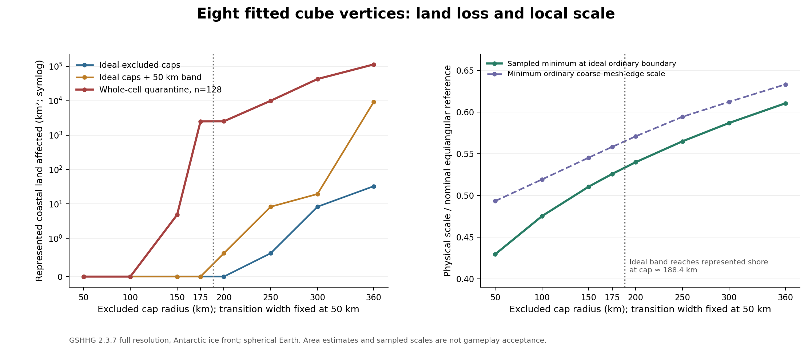

# 八顶点朝向与地理覆盖验证，2026-10-13

## Material Passport

- 任务：RFC #1，有限切除保角立方球的地理可行性验证。
- 类型：确定性代码实验；研究工具，不是游戏运行时验收。
- 输入：用户图片中的八个候选位置；GSHHG 2.3.7 完整/高分辨率海岸线；
  Nukumanu 附近一份有界 OSM 数据快照。
- 控制变量：同一刚体朝向、球半径 6,371,008.8 m、50 km 过渡带；
  切除半径 50/100/150/175/200/250/300/360 km。
- 输出：[旋转参数](geography/candidate-cube-orientation.json)、
  [位置拟合](geography/candidate-cube-fit.csv)、
  [海岸距离](geography/nearest-shorelines.csv)、
  [覆盖情景](geography/coverage-scenarios.csv)、
  [数据与方法记录](geography/coverage-passport.json)。
- 状态：朝向拟合和本数据集下的覆盖比较已完成；人口、全球道路/建筑、
  航运、最新海岸线完整性及游戏运行时验收仍未完成。

## 结论与推进决定

八个候选位置与同一旋转立方体相容。可以继续研究这个朝向，但不能把
“300 km 切除＋50 km 过渡”直接视为只影响无人海域的配置。
最紧的约束来自西太平洋：若保留所有 GSHHG 普通海岸多边形，拟合后的顶点
距最近海岸约 **238.42 km**；若过滤小于 10 km² 的普通陆地多边形，则约为
**488.02 km**，与图片报告相符。严格只保留 GSHHG 大陆记录时该距离约
**5,173.57 km**，所以“大陆”不能作为整张图片的字面解释。
300 km 的理想切除圆帽已经覆盖岛屿。
有限 OSM 探针还观测到该圆帽覆盖聚落和建筑。

建议保留 **100＋50 km** 作为当前粗网格的地理对照配置：本轮没有测得
正面积陆地交叠，普通边界的采样最小尺度约 **0.4753** 倍名义尺度。
它不是最终游玩配置，也没有已批准的尺度预算。若希望保持更高最小尺度，
应先收紧整格包围界并验证目标尺度局部网格，再比较 150＋50 km 等配置。
同时可搜索附近朝向，判断能否增加最小海岸余量。

## 八顶点拟合

将 `(Greenwich 赤道方向, 北极方向, 90°E 赤道方向)` 作为三维轴。
对全部 40,320 种顶点对应关系执行具有正行列式约束的 Kabsch 拟合，
最小化单位向量的平方弦长误差。立方体的 24 个正向对称产生等价物理顶点集；
按固定字典序选择数值并列的第一项，避免由插入顺序决定朝向。

拟合均方位置偏差 **3,139.658 m**，最大偏差 **4,327.429 m**。
旋转行列式约 1，最大正交误差为 1.89e-15。全部拟合经纬度均落在输入
0.1° 显示精度对应的最近舍入区间内。这说明输入与一个刚体旋转立方体
相容；它不证明图片中的海岸距离或地理价值判断成立。
对跖配对为 `(1,8)`、`(2,7)`、`(3,6)`、`(4,5)`；
[完整配对误差](geography/candidate-cube-pairwise.csv)保留了边、面对角线与对跖约束。

旋转由 `RotatedConformalCubedSphere` 接入独立研究映射，正向使用 `R`，
反向使用 `R^T`，包围半径保持不变。构造器拒绝反射、非正交和非有限矩阵，
并复制输入矩阵。旋转后的接缝、逆定位和隔离分类均有回归检查。
朝向 ID 只是研究版本信息，尚未形成持久化世界的版本准入协议。

## 海岸线核验

使用[作者官方 GSHHG 数据页](https://www.soest.hawaii.edu/pwessel/gshhg/)及其
2.3.7 原生二进制分发；官方页面和
[NOAA NCEI 页面](https://www.ngdc.noaa.gov/mgg/shorelines/shorelines.html)
提供来源与层级说明。下载归档及所用文件均锁定 SHA-256。
原生轮廓没有人为的日期变更线切割边；最近距离按球面短大圆弧计算，
而非仅寻找最近的存储顶点。该度量使用项目球半径，不是 WGS84 椭球距离。

完整分辨率、南极冰缘定义、拟合位置的结果如下：

| 顶点 | 候选区域 | 图片报告距离 km | 本轮实测 km |
|---:|---|---:|---:|
| 1 | 热带大西洋 | 1,117 | 1,108.47 |
| 2 | 西南印度洋 | 1,185 | 1,185.34 |
| 3 | 挪威海 | 360 | 357.49 |
| 4 | 孟加拉湾 | 386 | 365.71 |
| 5 | 东南太平洋 | 1,553 | 1,374.17 |
| 6 | 南大洋 | 580 | 581.44 |
| 7 | 东北太平洋 | 1,293 | 1,293.09 |
| 8 | 西太平洋 | 488 | 238.42 |

同样核验了未经拟合的图片坐标：顶点 8 的全海岸距离为 **236.07 km**，
而 10 km² 过滤后的距离为约 **485.51 km**。高分辨率数据对拟合坐标给出
240.67 km 和 488.03 km 两组对应结果。顶点 8 的 238 km 最近对象是约
0.03 km² 的小型海岸多边形；过滤后命中的约 8,724 km² 多边形位于
约 5.54°S、155.07°E，距离正好约 488 km。顶点 6 的 580 km 则来自南极
冰缘定义，严格大陆记录会变成约 4,863 km。
因此原文更可能使用了省略小岛的粗分辨率海岸数据或面积阈值，而不是一致的
“只计算大陆主体”规则。
最近海岸坐标、轮廓 ID、原始/拟合两种位置，以及两种南极定义都保存在原始表中。

面积阈值敏感性保存在[附加结果表](geography/shoreline-feature-thresholds.csv)。
其中 10 km² 只是解释原文距离的诊断情景，不是当前游戏规则。

## 理想圆帽与整格隔离的差异

理想 300 km 圆帽共覆盖约 **8.30 km²** 的记录陆地，加上 50 km 过渡带后
约 **19.42 km²**。然而当前 n=128 的整格隔离形状覆盖约 **42,623 km²**：
挪威海顶点约 9,792 km²，孟加拉湾顶点约 31,314 km²，
西太平洋顶点约 1,517 km²。

这是当前约 78 km 名义边长的粗网格和较松包围界下的结果，不能外推为
米级世界会损失同样面积。它说明应分别测量理想区域与实际被隔离的格子，
不能用理想圆帽面积替代当前实现的覆盖成本。

| 切除＋过渡 km | 理想普通边界采样最小尺度 | 整格隔离占球面比例 | 整格隔离的陆地交叠 km² |
|---|---:|---:|---:|
| 50＋50 | 0.4295 | 0.1938% | 0 |
| 100＋50 | 0.4753 | 0.2966% | 0 |
| 150＋50 | 0.5107 | 0.4061% | 4.84 |
| 175＋50 | 0.5259 | 0.4813% | 2,510.05 |
| 200＋50 | 0.5399 | 0.5851% | 2,520.11 |
| 250＋50 | 0.5650 | 0.7794% | 9,967.63 |
| 300＋50 | 0.5871 | 0.9759% | 42,623.11 |
| 360＋50 | 0.6106 | 1.2148% | 112,967.95 |

尺度下限是 181 条方向射线在理想普通边界上的采样极值，不是严格的
全球下界证明。表中的陆地使用沿岸包络，未扣除内陆湖泊；南极冰缘与
基岩接地线定义分别计算。数据年份为 2017，不能证明今日每一处沙洲与小岛。

面积使用各顶点局部的球面 Lambert 等积投影。每条映射边分别取 8 与
32 个子段，并对全部隔离边界做偶奇填充，保留孔洞与点接触分量。
300＋50 km 情景的两种边采样差约 **1.61 km²**，约为整格陆地交叠的
0.0038%；这只是边离散化敏感性，不是海岸线测量误差界。
简化高分辨率海岸线得到约 42,479 km²，和完整分辨率有约 0.34% 差异。

实际隔离形状也并非八个简单连通圆帽。例如 100＋50 km 的每个顶点邻域
产生 13 个多边形分量，300＋50 km 也是 13 个；150＋50 km 为 7 个。
这些是当前保守整格分类产生的额外隔离碎片，不能悄悄填平或忽略。
[边界结构表](geography/quarantine-boundary-structure.csv)记录了全部情景。
包围界收紧和隔离区域连通性应作为下一轮几何门槛。

## 有限地理对象探针

公开 Overpass 请求返回 406 后，成功通过 OSM 的有界只读 map 接口读取
`159.1°E–159.8°E, 4.7°S–4.4°S` 区域，并冻结相关数据，后续计算无需网络。
快照保留 OSM 对象 ID、版本和必要几何；数据 © OpenStreetMap contributors，
[ODbL 1.0](https://www.openstreetmap.org/copyright)。

在该探针范围内，300 km 理想切除区覆盖 **8 个聚落标注、66 个带 building
标签的闭合 way、1 个带 highway 标签的 way**。例如
[Amotu 聚落标注](https://www.openstreetmap.org/node/5500211435)位于该区域。
当前 n=128 的 150＋50 km 整格隔离也已经覆盖这些已观测对象，而相同配置的
理想圆帽和过渡带没有覆盖它们。这直接展示了保守整格扩张的影响。

[探针计数](geography/osm-probe-loss.csv)、
[命中对象及版本](geography/osm-probe-objects.csv)和
[快照记录](geography/osm-probe-passport.json)均可复核。
这些是有界数据内的标注对象计数，不是完整聚落或建筑总数。
人口标签缺失，因此人口损失为 **未知**，没有记为零。
该探针也不能代表挪威海、孟加拉湾或全部八个区域的道路/建筑损失；
建筑 relation、未映射对象、航运与航空路线尚未计量。

## 验证与复现

独立 Java 构建通过 **48 项检查**；Python 通过 **12 项检查**，
包括日期变更线、极点、弧内/端点最小距离、独立球面插值核验、
立方体拟合、破损数据、数据摘要不符，以及不完整 OSM 几何处理。
边界追踪专门验证了对角点接触与内部孔洞。
源数据在南极相关轮廓 4/5 上发生了平面/投影几何修复，修复 ID 在数据记录中
列出；本轮关键西太平洋、挪威海及孟加拉湾结果不使用这些南极修复。

复现入口与环境安装见 [工具说明](../../tools/geography/README.md)。
重新运行会构建独立 Java 输出目录，读取固定 GSHHG 和 OSM 输入，产生相同
表格与边界数据。运行时程序集、方块状态持久化、运动和碰撞没有在本轮验收。

## 下一阶段

1. 收紧曲面单元包围界，处理额外隔离碎片，并在目标尺度的局部块区验证
   100＋50、150＋50 km 等配置；避免预生成全球米级网格。
2. 搜索候选朝向附近的旋转，比较最小海岸余量、尺度和真实地理损失。
   完整复核候选区域的地理对象，再确定可接受的损失和尺度预算。
3. 通过地理与几何门槛后，接入带版本的权威方块身份、持久化和最小 Fabric
   接缝/边界场景，测试运动、碰撞、编辑与重载。
